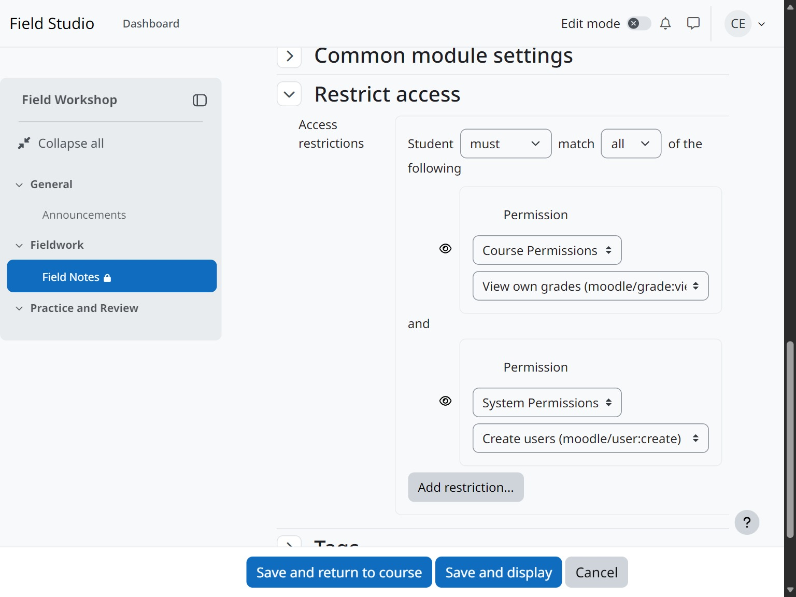
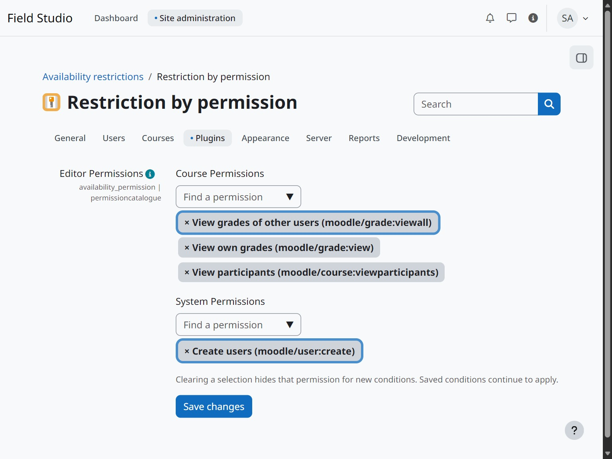
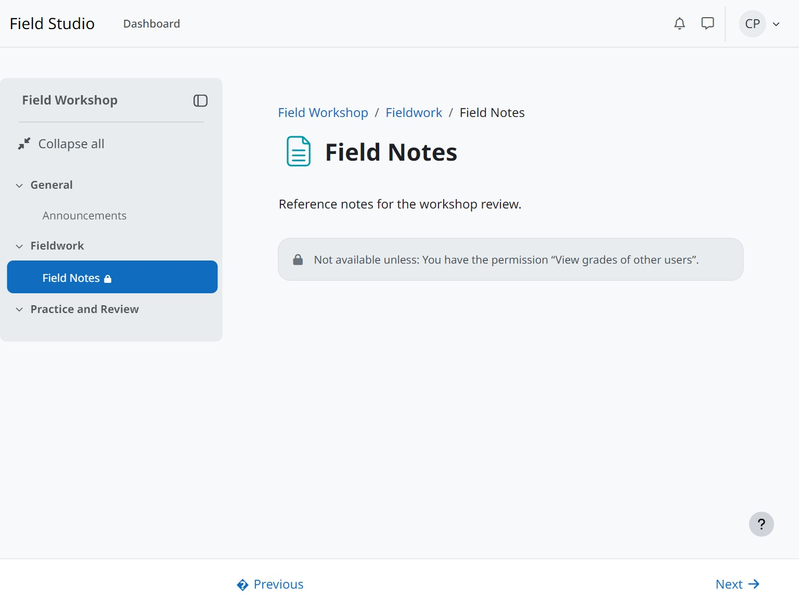

<!--
This file is part of Moodle - https://moodle.org/

Moodle is free software: you can redistribute it and/or modify
it under the terms of the GNU General Public License as published by
the Free Software Foundation, either version 3 of the License, or
(at your option) any later version.

Moodle is distributed in the hope that it will be useful,
but WITHOUT ANY WARRANTY; without even the implied warranty of
MERCHANTABILITY or FITNESS FOR A PARTICULAR PURPOSE. See the
GNU General Public License for more details.

You should have received a copy of the GNU General Public License
along with Moodle. If not, see <https://www.gnu.org/licenses/>.

@package    availability_permission
@copyright  2026 Andreas Giesen <andreas@108design.com>
@license    https://www.gnu.org/copyleft/gpl.html GNU GPL v3 or later
-->

  

# Restriction by permission

Restriction by permission adds a **Restrict access** condition for Moodle activities, resources and course sections. Use it when access should follow a Moodle permission your site already uses.

Screenshots

<table>
<tr>
<td width="50%" valign="top"> <strong>Permission conditions in an activity</strong> Choose a course or system permission in the Moodle activity settings.</td>
<td width="50%" valign="top"> <strong>Site administration permission catalogue</strong> Choose which course and system permissions are available when editors add a condition.</td>
</tr>
<tr>
<td width="50%" valign="top"> <strong>Access restriction shown to a participant</strong> Moodle explains which permission the participant needs to open the activity.</td>
<td width="50%"></td>
</tr>
</table>

Course editors choose a permission and decide whether participants must have it. Moodle checks course permissions in the relevant course, including role overrides, and system permissions at site level. Combine the condition with Moodle’s other access restrictions when a rule needs more than one check.

Site administrators choose which permissions appear in the editor. Course and system permissions have separate search fields, and the editor shows the capability ID beside its Moodle label. Removing a permission from the selection hides it for new conditions. Existing conditions that use it continue to apply.

Supports Moodle 4.5–5.3 with restricted access enabled.

## Install

Download the installation ZIP from the [latest release](https://github.com/108design/moodle-availability_permission/releases/latest).
Use Moodle’s plugin installer, or copy the files to `availability/condition/permission` in the Moodle web root.
Complete installation under **Site administration → Notifications**.

## Configure

Open **Site administration → Plugins → Availability restrictions → Restriction by permission** to manage the catalogue.
In an activity, resource or course section, choose **Restrict access → Add restriction → Permission**.
When restoring a course on another site, approve any additional capabilities there before using restored conditions.

## Licence

GNU General Public License v3 or later. See [COPYING.txt](COPYING.txt).
Available free of charge under the terms of the applicable license.

The 108design name and logo are subject to the [name and logo notice](TRADEMARKS.md).
